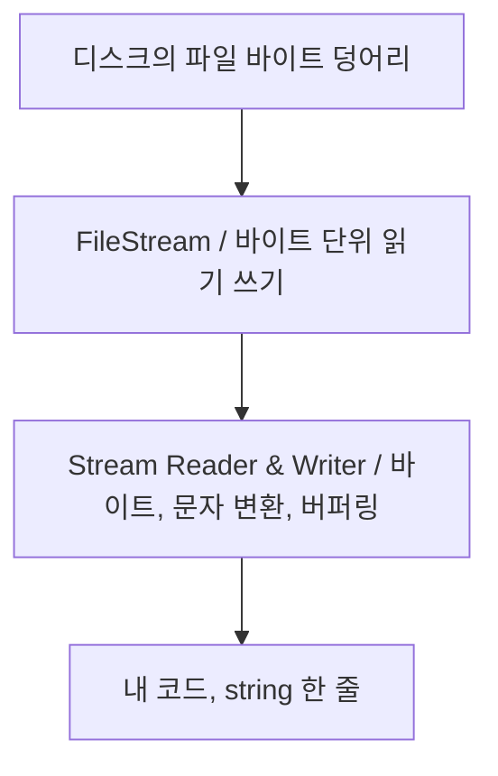

# File I/O
> C#과 유니티에서 file을 읽고 쓸 수 있는 방법  
> `File Input` `File Output`

## File IO ? 왜 배움?
프로그램에서 파일을 읽고 쓰는 상황은 매우 많습니다.

### 상황 예시
- 세이브 데이터 : 진행도, 인벤토리, 최고 점수
- 설정값 : 해상도, 볼륨, 키 바인딩
- 게임 데이터 테이블 : 아이템, 몬스터 스탯, 대사
- 로그 : 플레이 기록, 버그 출력용

> `PlayerPrefs`는 int/float/string만 저장할 수 있고
> 플랫폼에 따라 레지스트리 같은 곳에 저장되는 구조라
> 파일 구조가 복잡해지거나 커지면 감당이 안됩니다.
> `구조를 가진 데이터는 파일로 다루는게 정석입니다`

## Stream의 개념을 먼저 이해합시다

- `Stream` : 바이트 단위 입출력 객체
- `TextReader` / `TextWriter` : 문자 단위 입출력 객체
- `StreamReader` / `StreamWriter` : 위의 둘을 이어주는 객체(인코더)

> 즉, `StreamReader`와 `StreamWriter`는 "내가 준 문자열을 지정한 
> 인코딩으로 바꿔서, 버퍼에 모아놨다가 파일에 흘려보내는 놈"이다.  
> 이것만 기억하시면 됩니다.

**네임스페이스**
```csharp
using System.IO; // File, Directory, Path, StreamReader, StreamWriter
using System.Text // Encoding, StringBuilder
```
