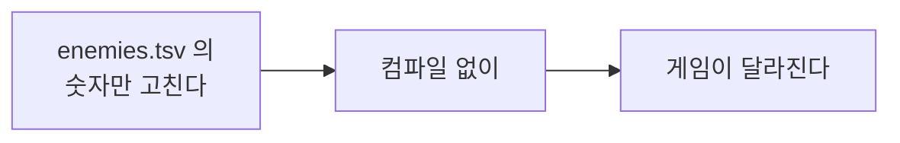
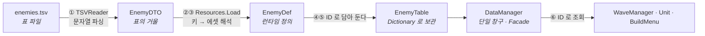
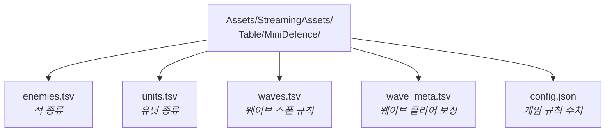
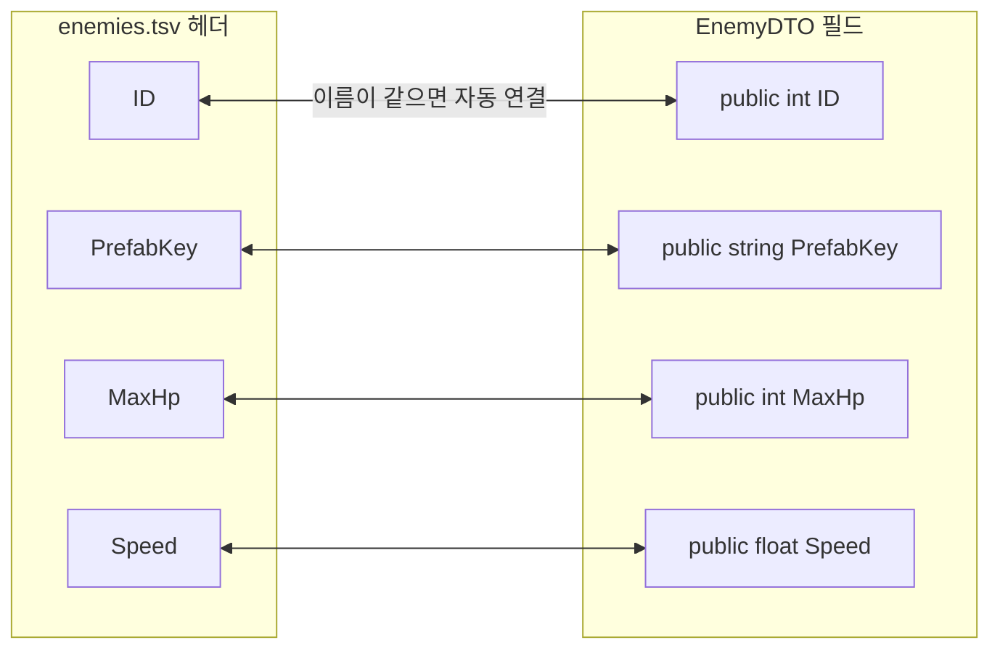
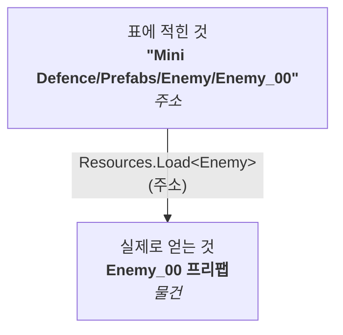
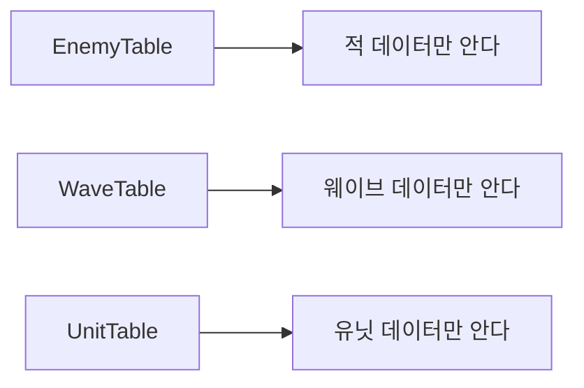
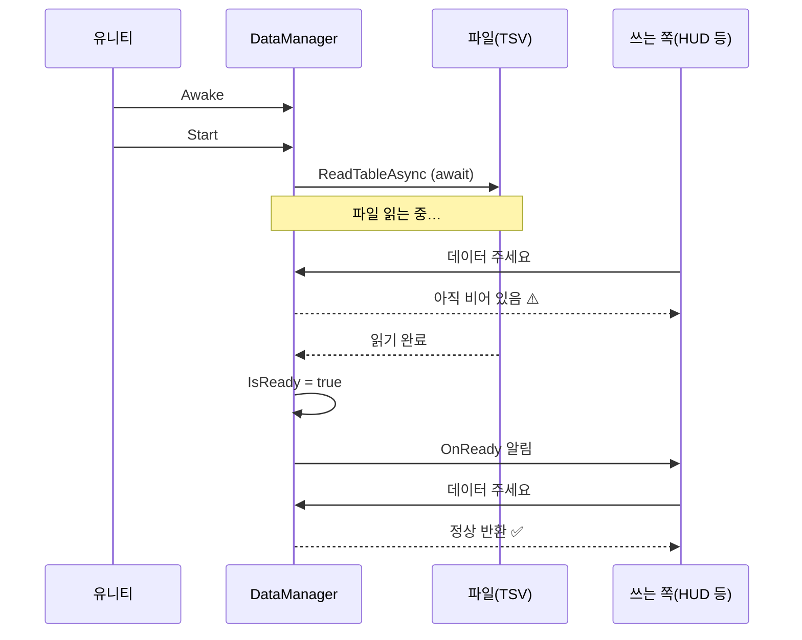
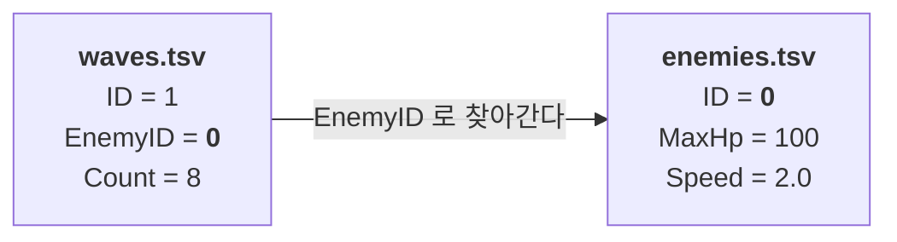
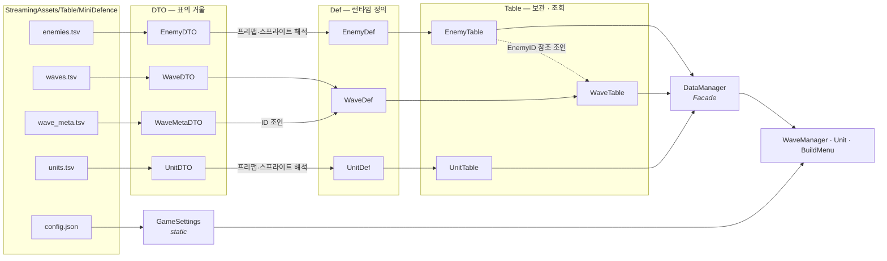

# 데이터 파이프라인 — 표(TSV)에서 게임까지

> 기획자가 만든 **표**가 어떻게 게임 속 **적과 유닛**이 되는가.

---

## 1. 왜 표에서 읽어오는가

적의 체력을 코드에 적어 두면 이렇게 된다.

```csharp
// 이렇게 만들면 어떤 일이 벌어지나?
if (enemyType == 0) { hp = 100; speed = 2.0f; }
else if (enemyType == 1) { hp = 60; speed = 3.5f; }
```

- 밸런스를 한 번 고칠 때마다 **컴파일**을 기다려야 한다
- 기획자가 숫자를 바꾸려면 **개발자에게 부탁**해야 한다
- 적을 한 종류 추가할 때마다 **`else if` 가 늘어난다**
- 빌드한 뒤에는 **아예 못 고친다**

표로 빼면 이 네 가지가 전부 사라진다.



**이 문서의 목표는 "표에 한 줄을 추가하면 게임에 적이 한 종류 늘어나는" 구조를 이해하는 것이다.**

---

## 2. 전체 흐름 한 장



단계마다 담당이 하나씩 있다.

| 단계         | 담당 | 하는 일 |
|------------|---|---|
| ① 읽기       | `TSVReader` (JayCore) | 파일의 글자를 C# 객체로 |
| ② 표의 거울    | `EnemyDTO` | 표 한 행을 그대로 담는 그릇 |
| ③ 런타임 정의, 해석 | `EnemyDef` | 게임이 바로 쓸 수 있는 완성된 형태 |
| ④ ⑤ 보관·조회    | `EnemyTable` | ID로 찾아 쓸 수 있게 딕셔너리에 넣어 둔다 |
| ⑥ 창구       | `DataManager` | 표들로 들어가는 입구 하나를 제공하고, 로딩 순서를 정한다 |

---

## 3. 표 파일은 어디에 두는가



### StreamingAssets 를 쓰는 이유

| 폴더 | 성격 | 빌드 후 수정 |
|---|---|---|
| 일반 `Assets/` | 유니티가 자기 형식으로 변환해 버린다 | 불가 |
| `Resources/` | 빌드에 통째로 들어간다 (에셋 전용) | 불가 |
| **`StreamingAssets/`** | **원본 파일 그대로 복사된다** | **가능** |

즉 빌드한 게임의 `StreamingAssets` 폴더를 열어 `enemies.tsv` 를 메모장으로 고치면, 다시 켰을 때 그 값으로 돌아간다.
이것이 "기획자가 직접 만지는 표"의 조건이다.

### TSV 를 쓰는 이유 (CSV 가 아니라)

| | 구분자 | 문제 |
|---|---|---|
| CSV | 쉼표 `,` | 텍스트 안에 쉼표가 들어가면 열이 깨진다 (`"파괴자, 보스"`) |
| **TSV** | **탭** | 사람이 텍스트에 탭을 넣는 일은 거의 없다 |

> ⚠️ **주의** : 탭은 눈에 보이지 않는다. 표를 손으로 편집할 때 스페이스를 넣으면 열이 어긋난다.
> 구글 스프레드시트에서 만들어 "탭으로 구분된 값"으로 내보내는 것이 안전하다.

---

## 4. ① 읽기 — TSVReader

```csharp
List<EnemyDTO> rows = await TSVReader.ReadTableAsync<EnemyDTO>("MiniDefence/enemies", true);
```

세 가지만 알면 된다.

**1) 헤더 이름 = 필드 이름**
표의 첫 줄(헤더)과 DTO 클래스의 필드 이름을 **글자 그대로** 맞추면 자동으로 채워진다.



이 짝짓기는 `CsvHelper` 라이브러리가 해 준다. 반사(Reflection)로 필드 이름을 읽어 헤더와 맞춘다.

> **가장 흔한 실수** : 표에 컬럼을 추가했는데 값이 안 들어온다
> → DTO 에 같은 이름의 필드를 추가했는지 확인한다. **오타 하나면 조용히 0이 들어온다.**

**2) 두 번째 인수 `true` = StreamingAssets 에서 읽기**
`false` 면 `persistentDataPath`(저장 폴더)에서 읽는다. 설정·저장 데이터를 나눠 담을 때 쓴다.

**3) `await` = 비동기**
파일 읽기는 시간이 걸리는 일이라 게임을 멈추지 않고 기다린다. 그래서 **"데이터가 준비된 시점"이 따로 필요**해진다 (→ 6장).

---

## 5. ② ③ ④ — DTO 와 Def 를 왜 나누는가

같은 파일 안에 두 클래스가 있다. **이 구분이 이 파이프라인의 핵심이다.**

```csharp
// [DTO] 표의 거울. 표에 적힌 그대로만 담는다.
public class EnemyDTO
{
    public int ID;
    public string PrefabKey;   // "Mini Defence/Prefabs/Enemy/Enemy_00"  ← 글자일 뿐
    public string SpriteKey;
    public int MaxHp;
    public float Speed;
    ...
}

// [Def] 런타임 정의. 게임이 바로 쓸 수 있는 형태.
public class EnemyDef
{
    public int ID;
    public Enemy Prefab;       // 실제 프리팹 참조!
    public Sprite Sprite;      // 실제 스프라이트 참조!
    public int MaxHp;
    public float Speed;
    ...
}
```

### 무엇이 다른가

|  | DTO | Def |
|---|---|---|
| 프리팹 | `string PrefabKey` — **글자** | `Enemy Prefab` — **참조** |
| 만드는 이 | TSVReader | EnemyTable |
| 성격 | 표를 그대로 옮긴 것 | 게임이 쓸 수 있게 완성된 것 |

### 왜 한 번에 안 하는가

표에는 **글자만** 적을 수 있다. `Enemy` 프리팹을 텍스트 파일에 넣을 방법은 없다.
그래서 표에는 **"어디에 있는지"만 적고**, 프로그램이 그 주소로 실제 물건을 찾아온다.



이 과정을 **키 해석(key resolution)** 이라고 한다. 택배 주소를 보고 집을 찾아가는 것과 같다.

> **정리** : DTO 는 "표에 뭐라고 적혀 있나", Def 는 "그래서 무엇을 쓸 건가".

---

## 6. ⑤ 보관·조회 — Table 클래스

`EnemyTable` 은 네 가지를 혼자 책임진다.

```csharp
public class EnemyTable
{
    private const string TableName = "MiniDefence/enemies";
    private readonly Dictionary<int, EnemyDef> defs = new();   // ⑤ 보관

    public EnemyDef Get(int id)                                 // ⑤ 조회
        => defs.TryGetValue(id, out EnemyDef def) ? def : null;

    public async Task LoadAsync()
    {
        List<EnemyDTO> rows = await TSVReader.ReadTableAsync<EnemyDTO>(TableName, true);  // ① 읽기
        if (rows == null) { Debug.LogError(...); return; }

        foreach (EnemyDTO dto in rows)
        {
            Enemy prefab = Resources.Load<Enemy>(dto.PrefabKey);   // ③ 키 해석
            if (prefab == null) Debug.LogWarning(...);             //   못 찾으면 알린다

            defs[dto.ID] = new EnemyDef { ... };                   // ④ Def 조립
        }
    }
}
```

### 왜 딕셔너리인가

리스트라면 "ID 2번 적"을 찾을 때 처음부터 훑어야 한다(O(n)).
딕셔너리는 ID로 바로 꺼낸다(O(1)). 적을 스폰할 때마다 찾으므로 이 차이가 쌓인다.

### 왜 표마다 클래스를 하나씩 두는가



한 클래스에 전부 넣으면 파일 하나가 계속 커지고, 적 데이터를 고치다 유닛 로딩을 망가뜨릴 수 있다.
**데이터 종류가 늘어나면 클래스를 하나 더 만든다.** 기존 클래스는 건드리지 않는다.

---

## 7. ⑥ 단일 창구 — DataManager (Facade)

```csharp
public class DataManager : SingletonBase<DataManager>
{
    public EnemyTable Enemies { get; } = new();
    public WaveTable Waves { get; } = new();
    public UnitTable Units { get; } = new();

    public bool IsReady { get; private set; }
    public event Action OnReady;

    private async void Start() => await LoadAsync();

    public async Task LoadAsync()
    {
        IsReady = false;

        await Enemies.LoadAsync();
        await Waves.LoadAsync(Enemies);   // ← 웨이브는 적에 의존한다
        await Units.LoadAsync();

        IsReady = true;
        OnReady?.Invoke();
    }

    // 하위 시스템으로 그대로 위임한다
    public EnemyDef GetEnemyDef(int id) => Enemies.Get(id);
    public WaveDef GetWaveDef(int id) => Waves.Get(id);
    public UnitDef GetUnitDef(int id) => Units.Get(id);
}
```

`DataManager` 는 **표를 직접 읽지 않는다.** 읽는 일은 각 Table 이 한다.
이쪽이 하는 일은 두 가지다.

### 하나 — 쓰기 쉬운 입구를 만든다 (퍼사드)

표가 3개, 앞으로 더 늘어난다. 쓰는 쪽이 매번 "적 데이터는 EnemyTable, 웨이브는 WaveTable…"을
기억해야 한다면 번거롭고, 표 구조가 바뀔 때마다 쓰는 쪽이 전부 흔들린다.

그래서 **입구를 하나로 모은다.**

```csharp
DataManager.Instance.GetEnemyDef(0)   // 뒤에 표가 몇 개인지 몰라도 된다
DataManager.Instance.IsReady          // 여러 표의 상태를 하나로 요약해서 알려 준다
```

이렇게 "여러 부품으로 들어가는 단일 창구"를 만드는 것을 **퍼사드(Facade)** 라고 한다.
건물 정면(facade)만 보고 들어가면 되고, 안에 방이 몇 개인지는 몰라도 되는 것과 같다.

> **퍼사드는 뒤쪽을 금지하는 게 아니다.** 쉬운 길을 하나 열어 두는 것이다.
> 그래서 표가 직접 필요하면 `Enemies` · `Waves` · `Units` 로 그냥 접근해도 된다.
> 실제로 `BuildMenu` 는 "유닛 전체 목록"이 필요하므로 `DataManager.Instance.Units.All` 을 직접 쓴다.

> **혼동하기 쉬운 것 — 중재자(Mediator)가 아니다.**
> 중재자는 "부품들이 서로를 모르고 전부 중재자를 거치는" 구조다.
> 여기서는 `WaveTable` 이 `EnemyTable` 을 직접 받아서 직접 쓴다. DataManager 는 넘겨주기만 한다.

### 둘 — 로딩 순서를 정한다

`waves.tsv` 에는 `EnemyID` 가 적혀 있다. 웨이브를 조립할 때 그 ID로 `EnemyDef` 를 찾아야 한다.
그래서 **적을 먼저 읽어야** 한다. 순서가 뒤바뀌면 웨이브가 전부 "알 수 없는 적"이 된다.

```csharp
await Waves.LoadAsync(Enemies);   // 완성된 적 테이블을 넘겨준다
```

의존 관계를 **매개변수로 드러낸** 것이다. 코드를 읽는 사람이 "웨이브는 적이 필요하구나"를 바로 안다.

### 데이터 종류를 추가하는 법 (두 줄)

```csharp
public UnitTable Units { get; } = new();   // ① 프로퍼티 한 줄
await Units.LoadAsync();                   // ② 로드 한 줄
```

이것이 6장의 "표마다 클래스 하나" 규칙이 주는 이득이다.

---

## 8. 비동기 로딩이 만드는 함정

파일 읽기는 시간이 걸린다. 그래서 **게임이 시작된 직후에는 데이터가 아직 없다.**



### 해결 : 물어보거나, 기다리거나

**방법 1 — 물어본다** (매 프레임 확인하는 곳)
```csharp
private void Update()
{
    if (DataManager.Instance.IsReady == false) return;   // 준비 안 됐으면 아무것도 안 한다
    ...
}
```

**방법 2 — 알림을 받는다** (한 번만 갱신하면 되는 곳)
```csharp
DataManager.Instance.OnReady += RefreshWave;   // 준비되면 불러 달라
```

`HUD` 가 "웨이브 0/3"을 표시할 때 이 방법을 쓴다. 처음에는 전체 웨이브 수가 0이지만, 로딩이 끝나면 알림을 받아 다시 그린다.

> **왜 이벤트인가** : `DataManager` 는 HUD가 있는지 모른다. "다 됐다"고 외치기만 하고, 듣고 싶은 쪽이 손을 든다.
> 이렇게 하면 데이터 쪽 코드는 UI가 늘어나도 바뀌지 않는다.

---

## 9. 표를 잇는 두 가지 방법

### 1:1 조인 — 웨이브와 보상

`waves.tsv`(스폰 규칙)와 `wave_meta.tsv`(클리어 보상)는 같은 `ID` 로 짝을 맺는다.

```csharp
// 보상을 ID로 바로 찾을 수 있게 미리 정리 (조인 준비)
Dictionary<int, int> rewardByWave = new();
foreach (WaveMetaDTO meta in metaRows)
    rewardByWave[meta.ID] = meta.ClearReward;

// 웨이브를 조립할 때 꺼내 쓴다
rewardByWave.TryGetValue(dto.ID, out int clearReward);
```

**왜 표를 나누는가** : "적을 어떻게 뿌리나"와 "다 막으면 얼마 주나"는 성격이 다른 정보다.
표를 나눠 두면 각 표가 한 가지만 설명하게 되고, 한쪽을 고칠 때 다른 쪽을 건드리지 않는다.

### 참조 조인 — 웨이브가 적을 가리킨다



```csharp
EnemyDef enemyDef = enemyTable.Get(dto.EnemyID);
if (enemyDef == null)
{
    Debug.LogWarning($"웨이브 {dto.ID}: 알 수 없는 EnemyID {dto.EnemyID} — 건너뜁니다.");
    continue;
}
```

관계형 데이터베이스의 **외래 키(foreign key)** 와 같은 개념이다.
같은 적을 여러 웨이브가 쓸 수 있고, 적의 체력을 고치면 그 적을 쓰는 모든 웨이브에 한 번에 반영된다.

---

## 10. 설정값은 JSON 으로 — 왜 형식을 나누나

```json
// config.json
{
    "StartingMinerals": 300,
    "RefundRate": 0.7,
    "StartingLives": 20,
    "CritMultiplier": 2.0
}
```

| | TSV | JSON |
|---|---|---|
| 어울리는 모양 | **같은 형태의 행이 여러 개** (적 3종, 유닛 3종) | **서로 다른 값이 하나씩** |
| 예 | `enemies.tsv` | `config.json` |

시작 광물과 환불 비율을 표로 만들면 열이 전부 달라서 억지스럽다. 반대로 적 3종을 JSON 배열로 만들면 표보다 읽기 어렵다.
**데이터의 모양에 맞는 형식을 고르는 것**도 설계다.

`GameSettings` 는 이 JSON 을 읽어 static 으로 들고 있다가, 누가 처음 물어볼 때 파일을 읽는다.

```csharp
GameSettings.Instance.RefundRate   // 어디서든, 초기화 순서 걱정 없이
```

---

## 11. 전체 데이터 지도



---

## 12. 직접 확인해 보기

### 실습 1 — 숫자만 고쳐 보기
1. `enemies.tsv` 에서 `MaxHp` 를 `100` → `1000` 으로
2. 저장하고 플레이
3. **컴파일이 없었는데** 적이 훨씬 단단해졌다

### 실습 2 — 적을 한 종류 추가하기
1. `enemies.tsv` 에 행 하나 추가 (ID=3, 프리팹 키는 기존 것 재사용)
2. `waves.tsv` 의 어느 웨이브 `EnemyID` 를 3으로
3. **코드를 한 줄도 고치지 않고** 새 적이 나온다

### 실습 3 — 일부러 틀려 보기
1. `enemies.tsv` 의 `PrefabKey` 를 없는 경로로 바꾼다
2. 콘솔에 경고가 뜬다 → **어디가 틀렸는지 바로 알 수 있다**
3. 이런 경고를 남기는 이유 : 조용히 넘어가면 "왜 적이 안 나오지?"를 한참 헤매게 된다

### 실습 4 — 순서를 망가뜨려 보기
1. `DataManager.LoadAsync` 에서 `Enemies` 와 `Waves` 로드 순서를 바꾼다
2. 웨이브가 전부 "알 수 없는 EnemyID" 경고를 낸다
3. **왜 순서가 중요한지**를 몸으로 확인한다

---

## 13. 요약

| 개념 | 한 줄 |
|---|---|
| StreamingAssets | 원본 파일 그대로 복사되어 **빌드 후에도 고칠 수 있다** |
| TSV | 탭 구분. 텍스트에 쉼표가 있어도 안전하다 |
| DTO | **표의 거울.** 적혀 있는 그대로만 담는다 |
| Def | **런타임 정의.** 문자열 키가 실제 에셋 참조로 해석된 완성형 |
| 키 해석 | 표의 주소(문자열)로 실제 에셋을 찾아오는 일 |
| Table 클래스 | 한 표의 로드·해석·보관·조회를 혼자 책임진다 |
| DataManager | 표를 읽지 않는다. **단일 창구(Facade)** + 로딩 순서 결정 |
| 로딩 순서 | 참조당하는 표를 먼저. (적 → 웨이브) |
| IsReady / OnReady | 비동기 로딩이라 **"준비됨"을 따로 알려야 한다** |

### 한 문장으로

> **표에는 글자만 적고, 프로그램이 그 글자를 실제 물건으로 바꿔서 딕셔너리에 넣어 둔다.
> 그 뒤로는 누구든 ID만 알면 꺼내 쓸 수 있다.**
